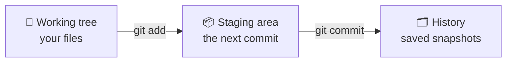

# M01 — Dev Environment, Git & GitHub

> [!NOTE]
> **Week 1 · Day 1 · about 4 hours.** Do the lessons in order, answer each checkpoint before
> moving on, then finish with the final exercise.

| | |
| --- | --- |
| 🎯 **You'll learn** | Set up your tools, use Git every day, and work through pull requests |
| 🛠️ **You'll build** | A merged pull request with a `hello-node` script and a resolved merge conflict |
| 👀 **Worked example** | [node-js-training](https://github.com/christine-baradero/node-js-training) · [PR #1](https://github.com/christine-baradero/node-js-training/pull/1) · [write-up](write-up.md) |

## 🗺️ Roadmap

| # | Lesson | Time |
| --- | --- | --- |
| 1 | [Toolchain setup](#1-toolchain-setup) | 30 min |
| 2 | [Terminal basics](#2-terminal-basics) | 10 min |
| 3 | [How Git stores your work](#3-how-git-stores-your-work) | 10 min |
| 4 | [Core Git commands](#4-core-git-commands) | 25 min |
| 5 | [Undoing commits: revert vs reset](#5-undoing-commits-revert-vs-reset) | 20 min |
| 6 | [Branches, merges, and conflicts](#6-branches-merges-and-conflicts) | 20 min |
| 7 | [`.gitignore` and `.env.example`](#7-gitignore-and-envexample) | 10 min |
| 8 | [GitHub: SSH, remotes, and pull requests](#8-github-ssh-remotes-and-pull-requests) | 25 min |
| 9 | [Final exercise](#9-final-exercise-your-first-pr-with-a-conflict) | 60 min |

---

## 1. Toolchain setup

*🎯 Install your tools and pin Node 24.*

| Tool | For | macOS | Windows | Check |
| --- | --- | --- | --- | --- |
| VS Code | Writing code | [Download](https://code.visualstudio.com) | `winget install Microsoft.VisualStudioCode` | `code --version` |
| Git | Version control | `brew install git` | `winget install Git.Git` | `git --version` |
| Node version manager | Switching Node versions | **nvm**: [install script](https://github.com/nvm-sh/nvm#installing-and-updating) | **fnm**: `winget install Schniz.fnm` | `nvm --version` / `fnm --version` |
| Node.js 24 | Running JavaScript | `nvm install 24` | `fnm install 24` | `node -v` |
| Bruno | Testing APIs (from M05) | `brew install --cask bruno` | `winget install Bruno.Bruno` | Open the app |

> [!TIP]
> **macOS:** `brew` needs [Homebrew](https://brew.sh). To get the `code` command, open VS Code and
> run *Shell Command: Install 'code' command in PATH* from the Command Palette.

> [!IMPORTANT]
> **Windows:** run every command in this module in **Git Bash**, which comes with Git. Then turn on
> fnm by adding this line to `~/.bashrc` and reopening Git Bash:
>
> ```bash
> eval "$(fnm env --use-on-cd --shell bash)"
> ```

**Pin the Node version** in your project root. `nvm use` / `fnm use` reads `.nvmrc` and switches to
it:

```bash
echo "24" > .nvmrc
nvm use        # Windows: fnm use
```

**Set your Git identity.** Git stamps this name and email on every commit:

```bash
git config --global user.name "Your Name"
git config --global user.email "you@company.com"
```

> [!TIP]
> Need a different email in one repo? Run the same commands without `--global` inside it. Check
> with `git config user.email` **before** your first commit.

### ✅ Checkpoint

1. Why install Node through a version manager instead of directly?
2. What does `.nvmrc` do?

<details>
<summary>Answers</summary>

1. Projects need different Node versions. A version manager installs several and switches between
   them per project.
2. It records the project's Node version, so `nvm use` or `fnm use` puts everyone on the same one.

</details>

---

## 2. Terminal basics

*🎯 Move around and manage files from the command line.*

| Command | What it does |
| --- | --- |
| `pwd` · `ls -la` | Where am I? · List files, including hidden ones like `.gitignore` |
| `cd <folder>` · `cd ..` | Go into a folder · Go up one level |
| `mkdir -p <folder>` | Create a folder, plus any missing parents |
| `cp <from> <to>` · `mv <from> <to>` | Copy · Move or rename |
| `cat <file>` | Print a file |
| `echo "text" > file` | Write to a file, **replacing** what's there |
| `echo "text" >> file` | **Add** to the end of a file |
| `rm <file>` · `rm -r <folder>` | Delete |

> [!WARNING]
> `rm` has no trash. Deleted files are gone for good.

### 🧪 Try it

```bash
mkdir -p ~/scratch/practice && cd ~/scratch/practice
echo "one" > notes.txt
echo "two" >> notes.txt
mv notes.txt renamed.txt
cat renamed.txt
```

### ✅ Checkpoint

What's in `renamed.txt`? What would it contain if both lines used `>`?

<details>
<summary>Answer</summary>

`one` and `two` on separate lines. With `>` twice, only `two`, because `>` overwrites the file.

</details>

---

## 3. How Git stores your work

*🎯 Understand the three places your changes live.*



| Place | What's in it |
| --- | --- |
| **Working tree** | Your files as they are on disk |
| **Staging area** | The changes you picked with `git add` |
| **Commit** | A saved snapshot with a message, an author, and a link to the commit before it |

Staging lets you commit only part of your work, so each commit stays **one logical change**. A
**branch** is just a pointer to a commit that moves forward each time you commit.

### ✅ Checkpoint

You edited `a.js` and `b.js` but only want to commit `a.js`. What do you run?

<details>
<summary>Answer</summary>

`git add a.js`, then `git commit -m "..."`. The change to `b.js` stays in the working tree.

</details>

---

## 4. Core Git commands

*🎯 Run the commands you'll use every day.*

| Command | What it does |
| --- | --- |
| `git init` · `git clone <url>` | Start a repo here · Copy a remote repo to your machine |
| `git status` | What's changed, staged, or untracked |
| `git add <file>` · `git commit -m "msg"` | Stage a change · Save staged changes as a commit |
| `git log --oneline` | List commits, one per line |
| `git diff` · `git diff --staged` | Unstaged changes · Staged changes |
| `git restore <file>` | **Discard** unstaged changes |
| `git restore --staged <file>` | **Unstage**, but keep the change |
| `git stash` · `git stash pop` | Set changes aside · Bring them back |

### 🧪 Try it

Run `git status` between steps to watch each change move:

```bash
mkdir -p ~/scratch/git-practice && cd ~/scratch/git-practice
git init
echo "hello" > a.txt
git status                   # a.txt is untracked
git add a.txt
git commit -m "chore: add a.txt"
echo "world" >> a.txt
git diff                     # shows the new line
git add a.txt
git diff --staged            # the same line, now staged
git restore --staged a.txt   # unstage it
git restore a.txt            # discard it
echo "draft" >> a.txt
git stash                    # set it aside
git stash pop                # bring it back
git log --oneline
```

### ✅ Checkpoint

What's the difference between `git restore a.txt` and `git restore --staged a.txt`?

<details>
<summary>Answer</summary>

`git restore a.txt` throws away unstaged changes for good. `git restore --staged a.txt` only
unstages the change, which stays in your working tree.

</details>

---

## 5. Undoing commits: revert vs reset

*🎯 Pick the right way to undo a commit.*

| | `git revert <commit>` | `git reset <commit>` |
| --- | --- | --- |
| **What it does** | Adds a new commit that undoes an earlier one | Moves the branch back, so later commits drop off |
| **History** | ✅ Kept | ⚠️ Rewritten |
| **On pushed commits?** | ✅ Safe | ❌ Needs a force-push |
| **Use it for** | Undoing something on `main` or another shared branch | Tidying local commits you haven't pushed |

The three `reset` modes differ in what happens to the undone changes:

| Mode | Changes are… |
| --- | --- |
| `--soft` | Kept and staged |
| `--mixed` (default) | Kept but unstaged |
| `--hard` | **Discarded** |

> [!WARNING]
> `git reset --hard` deletes your uncommitted work. Double-check before you run it.

### 🧪 Try it

```bash
mkdir -p ~/scratch/undo && cd ~/scratch/undo && git init
echo one > a.txt && git add a.txt && git commit -m "chore: one"
echo two >> a.txt && git commit -am "chore: two"
echo three >> a.txt && git commit -am "chore: three (mistake)"

git revert HEAD --no-edit
git log --oneline          # the mistake is still there, plus a "Revert" commit
cat a.txt                  # one, two

git reset --hard HEAD~1    # drop the revert commit
git reset --soft HEAD~1    # drop the mistake commit
git log --oneline          # the mistake is gone from history...
git status                 # ...but its change is still staged
```

### ✅ Checkpoint

You pushed a bad commit to `main`, and teammates already pulled it. Revert or reset?

<details>
<summary>Answer</summary>

Revert. It adds a new commit instead of rewriting history, so your teammates' copies stay valid.
Reset would need a force-push and break their copies.

</details>

---

## 6. Branches, merges, and conflicts

*🎯 Work on a branch, merge it, and fix a conflict.*

```bash
git switch -c feat/my-change   # create a branch and switch to it
git switch main                # switch back
git branch                     # list branches; * marks the current one
git merge feat/my-change       # merge that branch into the current one
```

**Conflicts** happen when two branches change the same lines, or both add the same file with
different content. Git can't choose, so it marks the file:

```text
<<<<<<< HEAD                          ← your current branch starts here
console.log("Hello, Node!");
=======                               ← the incoming branch starts here
console.log("Hello from branch B!");
>>>>>>> feat/greeting-b               ← end of the conflict
```

**To resolve:** keep the code you want → delete the three marker lines → `git add` the file →
`git commit`.

> [!TIP]
> **GitHub or locally?** GitHub's *Resolve conflicts* editor handles simple conflicts, like
> competing changes to the same lines. For anything more complex, or if the button is disabled,
> resolve it locally. Resolving on GitHub merges the whole base branch into your branch.

**Merge vs rebase**

| | Merge | Rebase |
| --- | --- | --- |
| **How** | Adds a merge commit joining the two branches | Replays a branch's commits on top of another |
| **History** | Kept as it was, so you can see where branches joined | A straight line, but every commit gets a new hash |
| **Use when** | Commits are already shared | Commits are still local only |

Rebasing shared commits needs a force-push and breaks other people's copies. This applies whether
the repo is public or private.

### ✅ Checkpoint

1. What causes a merge conflict?
2. In the conflict above, which version is from your current branch?

<details>
<summary>Answers</summary>

1. Two branches changing the same lines, or both adding the same file with different content.
2. `console.log("Hello, Node!");`, the part between `<<<<<<< HEAD` and `=======`.

</details>

💪 You'll create and resolve a real conflict in the final exercise.

---

## 7. `.gitignore` and `.env.example`

*🎯 Keep generated files and secrets out of Git.*

`.gitignore` lists files Git should never track. For a Node project:

```gitignore
node_modules
.env
*.db
src/generated/prisma
dist
coverage
```

| Entry | Why |
| --- | --- |
| `node_modules` | Installed packages. Huge, and `npm install` rebuilds it |
| `.env` | Secrets like API keys and passwords |
| `*.db` | Local SQLite databases |
| `src/generated/prisma` | Code Prisma generates (M07) |
| `dist` · `coverage` | Compiled output (M04) · Test coverage reports (M09) |

**Never commit `.env`.** Commit a `.env.example` with placeholder values instead, so others know
which settings to create:

```bash
# Copy to .env and fill in real values. Never commit .env.
```

> [!TIP]
> `git check-ignore -v .env` prints the rule that ignores a file.

### ✅ Checkpoint

Why commit `.env.example` but never `.env`?

<details>
<summary>Answer</summary>

`.env` holds real secrets, and a public repo would expose them. `.env.example` shows which
settings exist without their values.

</details>

---

## 8. GitHub: SSH, remotes, and pull requests

*🎯 Connect to GitHub and share work through pull requests.*

**Connect with SSH** (once per machine):

```bash
ssh-keygen -t ed25519 -C "you@company.com"
cat ~/.ssh/id_ed25519.pub      # paste into GitHub → Settings → SSH and GPG keys
ssh -T git@github.com          # should greet you by username
```

**Remotes** are the GitHub copies of your repo:

| Command | What it does |
| --- | --- |
| `git remote -v` | Show remotes, usually `origin` |
| `git remote add origin <url>` | Connect a repo made with `git init` (`git clone` does this for you) |
| `git push -u origin <branch>` | Push a branch and link it, so next time `git push` is enough |
| `git pull` | Fetch and merge the latest changes |

**GitHub Flow:** branch from `main` → commit → push → open a PR → review → merge. `main` only
changes through merged PRs, so it always holds reviewed work.

**Conventional Commits:** start each message with its type.

| Type | For | Example |
| --- | --- | --- |
| `feat` | New features | `feat: add hello-node script` |
| `fix` | Bug fixes | `fix: handle empty input` |
| `docs` | Documentation | `docs: add README` |
| `chore` | Setup and config | `chore: add .nvmrc pinning Node 24` |

Other common types are `refactor` and `test`.

> [!TIP]
> Typo in your last message? `git commit --amend -m "docs: add README"` fixes it. Only amend
> commits you haven't pushed.

### ✅ Checkpoint

Why open a pull request instead of pushing straight to `main`?

<details>
<summary>Answer</summary>

The PR is where the change gets reviewed before it reaches `main`, so `main` only gets reviewed
work.

</details>

---

## 9. Final exercise: your first PR with a conflict

*🎯 Take a change through branch → PR → merge, including a real conflict.*

**Step 1. Create a public repository** in the GitHub web interface.

**Step 2. Clone it** and check your Git identity before committing anything:

```bash
git clone git@github.com:<your-username>/node-js-training.git
cd node-js-training
git config user.email
```

**Step 3. Build on a first branch**, with one Conventional Commit per change:

```bash
git switch -c feat/hello-node
echo 'console.log("Hello, Node!");' > hello-node.js
node hello-node.js
git add hello-node.js
git commit -m "feat: add hello-node script"
echo "24" > .nvmrc
git add .nvmrc
git commit -m "chore: add .nvmrc pinning Node 24"
# create .gitignore and .env.example (lesson 7)
git add .gitignore .env.example
git commit -m "chore: add .gitignore and .env.example"
git push -u origin feat/hello-node
```

Open **PR 1** into `main`. Don't merge it yet.

**Step 4. Set up the conflict** with a second branch that adds the same file differently:

```bash
git switch main
git switch -c feat/greeting-b
echo 'console.log("Hello from branch B!");' > hello-node.js
git add hello-node.js
git commit -m "feat: add hello-node script on branch b"
git push -u origin feat/greeting-b
```

Open **PR 2** into `main`, then **merge PR 2 first**. `main` now has a `hello-node.js` your first
branch doesn't know about, so GitHub reports a conflict on PR 1.

**Step 5. Resolve it on GitHub.** On PR 1, click *Resolve conflicts*, keep the version you want,
delete the marker lines, then click *Mark as resolved* → *Commit merge*.

**Step 6. Merge PR 1** with *Create a merge commit*.

> [!WARNING]
> Don't use *Squash and merge* here. It collapses your commits into one and hides the conflict
> resolution.

**Step 7. Sync locally:**

```bash
git switch main
git pull
git log --oneline --graph
```

🧹 Done practicing? Delete the scratch folders with `rm -rf ~/scratch`.

### 🏁 Done when

- [ ] Your PR is merged with 3 or more Conventional Commits
- [ ] `.gitignore` is present and covers the list in lesson 7
- [ ] `.env.example` is present
- [ ] You can explain `git revert` vs `git reset` out loud

🎉 **That's M01.** Next up: M02, Modern JavaScript & Async/Await.
